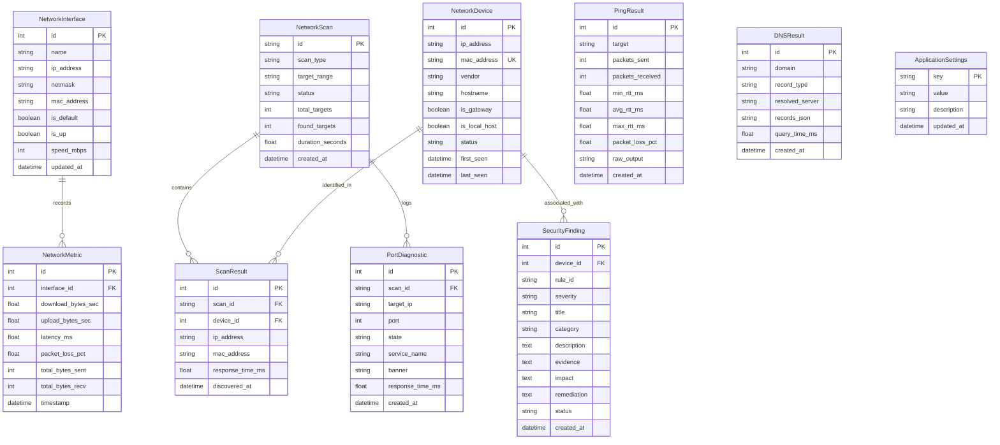

# NetScope Database Schema Specification

## 1. Overview & Architecture
NetScope uses **SQLite 3** configured in **Write-Ahead Logging (WAL)** mode (`PRAGMA journal_mode = WAL;`) through **SQLAlchemy 2.0 (Asyncio)**. This architecture ensures high-throughput, non-blocking telemetry writes from background monitoring loops while concurrently servicing read queries from the web dashboard. The schema is designed for full PostgreSQL compatibility should enterprise deployment be needed.

---

## 2. Entity-Relationship Diagram

---

## 3. Table Definitions & Constraints

### 3.1 `network_interfaces`
Tracks all physical and virtual network adapters discovered on the host system.
- `id` (INTEGER, Primary Key, Autoincrement)
- `name` (VARCHAR(128), Not Null, Index)
- `ip_address` (VARCHAR(45), Nullable)
- `netmask` (VARCHAR(45), Nullable)
- `mac_address` (VARCHAR(17), Nullable)
- `is_default` (BOOLEAN, Default False)
- `is_up` (BOOLEAN, Default True)
- `speed_mbps` (INTEGER, Nullable)
- `updated_at` (DATETIME, Default CURRENT_TIMESTAMP)

### 3.2 `network_devices`
Maintains the inventory of discovered LAN devices across scans.
- `id` (INTEGER, Primary Key, Autoincrement)
- `ip_address` (VARCHAR(45), Not Null, Index)
- `mac_address` (VARCHAR(17), Unique, Nullable, Index)
- `vendor` (VARCHAR(255), Default "Unknown")
- `hostname` (VARCHAR(255), Nullable)
- `is_gateway` (BOOLEAN, Default False)
- `is_local_host` (BOOLEAN, Default False)
- `status` (VARCHAR(32), Default "online")
- `first_seen` (DATETIME, Default CURRENT_TIMESTAMP)
- `last_seen` (DATETIME, Default CURRENT_TIMESTAMP)

### 3.3 `network_scans`
Records metadata for every executed subnet discovery or port diagnostic scan.
- `id` (VARCHAR(64), Primary Key)
- `scan_type` (VARCHAR(32), Not Null) -- 'device_discovery', 'port_scan'
- `target_range` (VARCHAR(128), Not Null)
- `status` (VARCHAR(32), Not Null) -- 'in_progress', 'completed', 'failed', 'stopped'
- `total_targets` (INTEGER, Default 0)
- `found_targets` (INTEGER, Default 0)
- `duration_seconds` (FLOAT, Default 0.0)
- `created_at` (DATETIME, Default CURRENT_TIMESTAMP)

### 3.4 `scan_results`
Individual device observations linked to a parent `network_scan`.
- `id` (INTEGER, Primary Key, Autoincrement)
- `scan_id` (VARCHAR(64), Foreign Key `network_scans.id`, Index)
- `device_id` (INTEGER, Foreign Key `network_devices.id`, Nullable)
- `ip_address` (VARCHAR(45), Not Null)
- `mac_address` (VARCHAR(17), Nullable)
- `response_time_ms` (FLOAT, Nullable)
- `discovered_at` (DATETIME, Default CURRENT_TIMESTAMP)

### 3.5 `network_metrics`
Time-series bandwidth and latency measurements captured by the telemetry background service.
- `id` (INTEGER, Primary Key, Autoincrement)
- `interface_id` (INTEGER, Foreign Key `network_interfaces.id`, Nullable)
- `download_bytes_sec` (FLOAT, Not Null)
- `upload_bytes_sec` (FLOAT, Not Null)
- `latency_ms` (FLOAT, Nullable)
- `packet_loss_pct` (FLOAT, Default 0.0)
- `total_bytes_sent` (BIGINT, Not Null)
- `total_bytes_recv` (BIGINT, Not Null)
- `timestamp` (DATETIME, Default CURRENT_TIMESTAMP, Index)

### 3.6 `ping_results`
Audit log of manual and scheduled ICMP ping operations.
- `id` (INTEGER, Primary Key, Autoincrement)
- `target` (VARCHAR(255), Not Null)
- `packets_sent` (INTEGER, Not Null)
- `packets_received` (INTEGER, Not Null)
- `min_rtt_ms` (FLOAT, Nullable)
- `avg_rtt_ms` (FLOAT, Nullable)
- `max_rtt_ms` (FLOAT, Nullable)
- `packet_loss_pct` (FLOAT, Not Null)
- `raw_output` (TEXT, Nullable)
- `created_at` (DATETIME, Default CURRENT_TIMESTAMP)

### 3.7 `dns_results`
Audit log of DNS query operations and resolved record sets.
- `id` (INTEGER, Primary Key, Autoincrement)
- `domain` (VARCHAR(255), Not Null)
- `record_type` (VARCHAR(16), Not Null)
- `resolved_server` (VARCHAR(64), Nullable)
- `records_json` (TEXT, Not Null)
- `query_time_ms` (FLOAT, Nullable)
- `created_at` (DATETIME, Default CURRENT_TIMESTAMP)

### 3.8 `port_diagnostics`
Results of targeted TCP connect scans.
- `id` (INTEGER, Primary Key, Autoincrement)
- `scan_id` (VARCHAR(64), Foreign Key `network_scans.id`, Nullable, Index)
- `target_ip` (VARCHAR(45), Not Null)
- `port` (INTEGER, Not Null)
- `state` (VARCHAR(16), Not Null) -- 'open', 'closed', 'filtered'
- `service_name` (VARCHAR(64), Nullable)
- `banner` (TEXT, Nullable)
- `response_time_ms` (FLOAT, Nullable)
- `created_at` (DATETIME, Default CURRENT_TIMESTAMP)

### 3.9 `security_findings`
Automated auditing issues identified by the security analyzer.
- `id` (INTEGER, Primary Key, Autoincrement)
- `device_id` (INTEGER, Foreign Key `network_devices.id`, Nullable)
- `rule_id` (VARCHAR(32), Not Null)
- `severity` (VARCHAR(16), Not Null) -- 'critical', 'high', 'medium', 'low', 'info'
- `title` (VARCHAR(255), Not Null)
- `category` (VARCHAR(64), Not Null)
- `description` (TEXT, Not Null)
- `evidence` (TEXT, Not Null)
- `impact` (TEXT, Not Null)
- `remediation` (TEXT, Not Null)
- `status` (VARCHAR(32), Default "active")
- `created_at` (DATETIME, Default CURRENT_TIMESTAMP)

### 3.10 `application_settings`
Key-value configuration store for user preferences and scanning parameters.
- `key` (VARCHAR(128), Primary Key)
- `value` (TEXT, Not Null)
- `description` (VARCHAR(255), Nullable)
- `updated_at` (DATETIME, Default CURRENT_TIMESTAMP)

---

## 4. Indexing & Optimization Strategy
- Indexes created on `network_devices.ip_address` and `network_devices.mac_address` for instant ARP cache lookups.
- Composite index on `network_metrics(timestamp DESC)` for high-speed dashboard telemetry time-series slicing.
- Automatic vacuum and metric pruning: metrics older than 7 days can be pruned via a lightweight background task.
